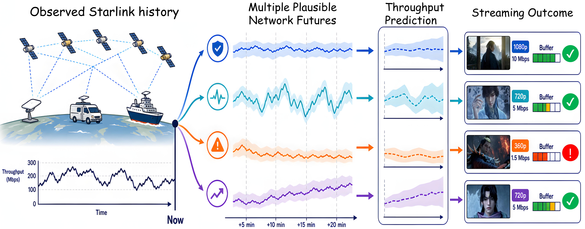
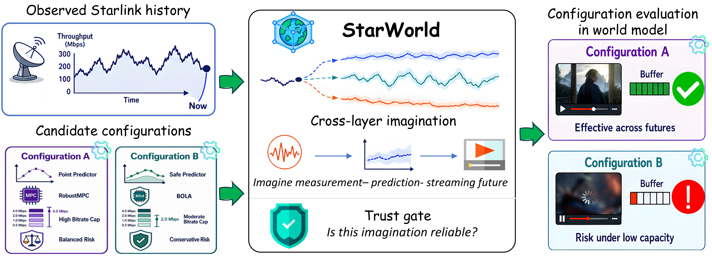
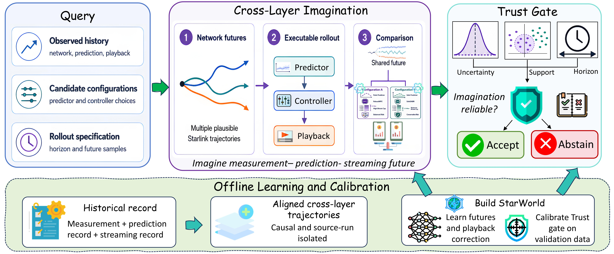

<div align="center">

# StarWorld

### A Cross-Layer World Model for Starlink Prediction and Streaming

[](pyproject.toml)
[](https://pytorch.org/)
[](LICENSE)

**Imagine multiple network futures. Trace their application consequences. Assess their reliability.**

[English](README.md) | [简体中文](README_CN.md)

[Background](#background) · [Overview](#overview) · [Quick Start](#quick-start) · [Method](#method) · [Data](#starlink-data) · [Documentation](#documentation)

</div>

## Background

Starlink supports broadband connectivity across fixed, mobile, and maritime settings. Its access conditions vary over time, so similar observed histories can lead to stable, volatile, or low-capacity continuations. These differences propagate into throughput estimates, bitrate decisions, buffer levels, and playback quality.

<p align="center">
  
</p>

*Illustration of how one observed history can develop into different network futures and prediction and playback outcomes.*

Understanding these cross-layer effects calls for multiple plausible futures and a common environment for following prediction and streaming behavior along each future.

## Overview

**StarWorld provides a cross-layer imagination environment.** Starting from an observed history, it samples network futures, executes prediction and streaming processes along those futures, and compares the resulting playback outcomes. A calibrated **Trust Gate** assesses uncertainty, data support, and rollout horizon to determine when the imagined results can be used.

<p align="center">
  
</p>

*One observed history, multiple plausible network futures, and linked prediction and streaming consequences.*

| Capability | What it provides |
| --- | --- |
| Probabilistic network dynamics | Multiple temporally evolving network continuations |
| Executable cross-layer rollout | Prediction, bitrate decisions, buffer evolution, and rebuffering along each future |
| Shared-future comparison | Paired configuration effects under the same network randomness |
| Calibrated Trust Gate | Reliability decisions informed by uncertainty, joint support, and horizon |
| Cross-layer data preparation | Causal measurement windows and aligned playback records |

## Quick Start

Use Python 3.10 or newer. From a clone of this repository:

```bash
python -m venv .venv
source .venv/bin/activate
python -m pip install -e '.[viz]'

python examples/minimal_demo.py --plot
```

The CPU example generates synthetic cross-layer sequences, trains a small ensemble, refines its playback correction, calibrates the Trust Gate on validation sequences, and compares two streaming policies under shared sampled futures.

The same walkthrough is available from the command line:

```bash
starworld demo --epochs 2 --members 2 --plot --output outputs/demo
```

Outputs include:

| File | Content |
| --- | --- |
| `outputs/demo/imagination.png` | Sampled network futures, imagined buffer, and rebuffering |
| `outputs/demo/summary.json` | Branch summaries, paired effects, and trust decisions |
| `outputs/demo/model/` | Trained members, split manifest, and calibration |

The example's synthetic inputs are created at runtime. Its trust decisions reflect the fitted model and validation calibration.

## Method

<p align="center">
  
</p>

**Offline:** align cross-layer trajectories, learn stochastic network dynamics and a playback correction, then calibrate reliability thresholds on validation data.

**At query time:** condition on observed history, sample network futures, execute the configured predictor and controller, advance playback states, compare branches under shared futures, and apply the Trust Gate.

```text
Observed history + candidate configurations
                     |
             Sample network futures
                     |
          Execute prediction -> control -> playback
                     |
           Compare shared-future outcomes
                     |
       Trust Gate: uncertainty / support / horizon
                     |
             Accept or abstain
```

The code follows the same organization:

| Component | Entry point |
| --- | --- |
| Public workflow | [`src/starworld/api.py`](src/starworld/api.py) |
| Stochastic network dynamics | [`models/world_model.py`](src/starworld/models/world_model.py) |
| Predictor and controller interfaces | [`interfaces/`](src/starworld/interfaces) |
| Analytical playback and learned correction | [`interfaces/streaming.py`](src/starworld/interfaces/streaming.py), [`training/playback.py`](src/starworld/training/playback.py) |
| Cross-layer imagination | [`rollout/engine.py`](src/starworld/rollout/engine.py) |
| Trust Gate | [`rollout/trust.py`](src/starworld/rollout/trust.py) |
| Measurement and replay alignment | [`data/`](src/starworld/data) |

See the [method walkthrough](docs/method.md) for the data flow and [usage guide](docs/usage.md) for training and query examples.

## Starlink Data

StarWorld uses measurements from **[StarNet](https://github.com/ConnectedSystemsLab/StarNet)**, released with *[Vivisecting Starlink Throughput: Measurement and Prediction](https://doi.org/10.1145/3768971)*, Proceedings of the ACM on Networking / CoNEXT, 2025. The official repository provides measurement sources for the United States, Germany, and Canada.

Obtain the measurements from the official source and prepare them locally:

```bash
starworld prepare-data \
  --input-root /path/to/starnet \
  --output outputs/tables
```

The pipeline reads official measurement logs, aggregates repeated timestamps, handles short gaps, creates segments, and constructs causal history windows with separate future targets. Playback logs can be connected through a replay index to build aligned cross-layer episodes.

The [data preparation guide](docs/data.md) documents the source reference, input formats, units, replay-index schema, and commands for the complete data-to-training workflow.

## Documentation

- [Method walkthrough](docs/method.md): core logic and module relationships.
- [Data preparation](docs/data.md): StarNet sources, preprocessing, and cross-layer alignment.
- [Training and imagination](docs/usage.md): public API, CLI, and extension interfaces.
- [Maintenance](docs/maintenance.md): code map and verification checklist.

## Development

```bash
python -m unittest discover -s tests -v
```

The tests cover causal inputs, grouped data splits, exogenous network dynamics, executable playback, shared-future comparisons, and trust decisions. GitHub Actions runs the tests and a CPU walkthrough.

## License and Acknowledgments

StarWorld's code is released under the [MIT License](LICENSE). We thank the StarNet authors for making their measurement tools and dataset available. Dataset access and attribution follow the [original source](https://github.com/ConnectedSystemsLab/StarNet).
