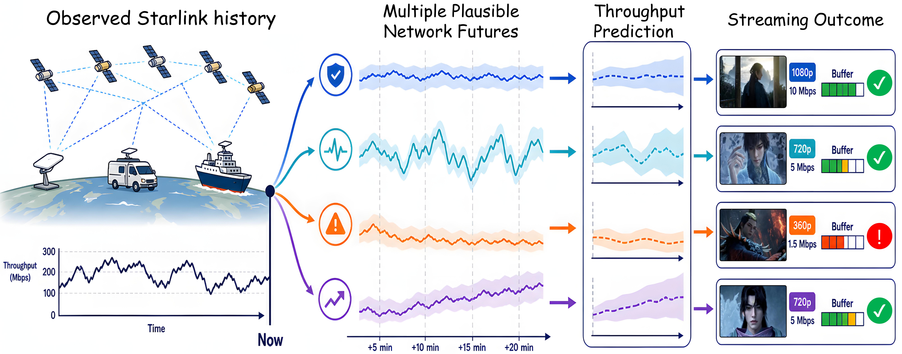
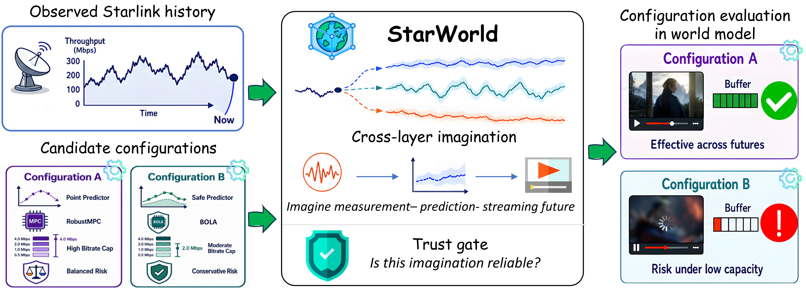
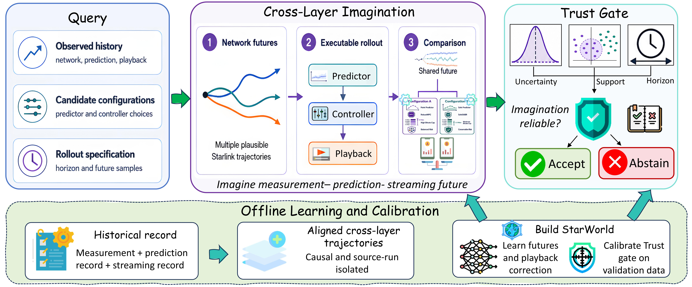

<div align="center">

# StarWorld

### 面向 Starlink 预测与流媒体的跨层世界模型

[](pyproject.toml)
[](https://pytorch.org/)
[](LICENSE)

**想象多种网络未来，推演跨层应用后果，评估结果的可靠性。**

[English](README.md) | [简体中文](README_CN.md)

[研究背景](#研究背景) · [项目概览](#项目概览) · [快速开始](#快速开始) · [方法流程](#方法流程) · [数据准备](#starlink-数据) · [文档](#文档)

</div>

## 研究背景

Starlink 为固定终端、移动车辆和海上场景提供宽带连接。其接入条件随时间变化，相似的观测历史可能延续为稳定、剧烈波动或低容量的网络状态。这些差异会进一步影响吞吐量预测、码率决策、缓冲区和播放质量。

<p align="center">
  
</p>

*示意：相同的观测历史可能延续为不同网络未来，并产生不同的预测与播放后果。*

理解这些跨层影响，需要考虑多种可能的未来，并在统一环境中沿每条未来推演预测与流媒体行为。

## 项目概览

**StarWorld 提供一个跨层想象环境。** 它从观测历史出发，采样网络未来，沿每条未来执行预测与流媒体过程，并比较相应的播放结果。经过校准的 **Trust Gate** 结合不确定性、数据支持和推演跨度，判断想象结果何时可供使用。

<p align="center">
  
</p>

*同一段观测历史，多种可能的网络未来，以及相互关联的预测与播放后果。*

| 核心能力 | 提供的内容 |
| --- | --- |
| 概率网络动态 | 随时间演化的多种网络延续 |
| 可执行跨层推演 | 每条未来上的容量预测、码率决策、缓冲区与卡顿状态 |
| 共享未来比较 | 在相同网络随机性下比较不同配置的成对效果 |
| 校准的 Trust Gate | 结合不确定性、联合支持和时间跨度的可靠性判断 |
| 跨层数据处理 | 因果测量窗口及对齐的播放记录 |

## 快速开始

使用 Python 3.10 或更新版本，在克隆的仓库目录中运行：

```bash
python -m venv .venv
source .venv/bin/activate
python -m pip install -e '.[viz]'

python examples/minimal_demo.py --plot
```

这个 CPU 示例会生成合成跨层序列，训练小型集成模型，优化播放校正器，在验证序列上校准 Trust Gate，并让两种流媒体策略在共享网络未来下进行比较。

同样的流程也可以通过命令行执行：

```bash
starworld demo --epochs 2 --members 2 --plot --output outputs/demo
```

主要输出如下：

| 文件 | 内容 |
| --- | --- |
| `outputs/demo/imagination.png` | 网络未来、播放缓冲区和累计卡顿的可视化 |
| `outputs/demo/summary.json` | 配置分支结果、成对差异与信任判断 |
| `outputs/demo/model/` | 训练后的模型、数据划分记录与校准结果 |

示例的合成输入在运行时生成，信任判断由训练后的模型与验证集校准共同决定。

## 方法流程

<p align="center">
  
</p>

**离线阶段：** 对齐跨层轨迹，学习随机网络动态与播放校正器，并使用验证数据校准可靠性阈值。

**查询阶段：** 从观测历史出发采样网络未来，执行配置指定的预测器和控制器，推进播放状态，在共享未来下比较分支结果，最后由 Trust Gate 给出判断。

```text
观测历史 + 候选配置
        |
    采样网络未来
        |
执行预测 -> 控制 -> 播放
        |
 比较共享未来下的结果
        |
Trust Gate：不确定性 / 支持 / 时间跨度
        |
    接受或弃权
```

代码入口与上述流程对应：

| 组件 | 入口 |
| --- | --- |
| 公开工作流接口 | [`src/starworld/api.py`](src/starworld/api.py) |
| 随机网络动态 | [`models/world_model.py`](src/starworld/models/world_model.py) |
| 预测器与控制器接口 | [`interfaces/`](src/starworld/interfaces) |
| 解析播放过程与学习校正 | [`interfaces/streaming.py`](src/starworld/interfaces/streaming.py)、[`training/playback.py`](src/starworld/training/playback.py) |
| 跨层想象 | [`rollout/engine.py`](src/starworld/rollout/engine.py) |
| Trust Gate | [`rollout/trust.py`](src/starworld/rollout/trust.py) |
| 测量与播放记录对齐 | [`data/`](src/starworld/data) |

各模块的数据流见[方法说明](docs/method.md)，训练和查询案例见[使用指南](docs/usage.md)。

## Starlink 数据

StarWorld 使用 **[StarNet](https://github.com/ConnectedSystemsLab/StarNet)** 的测量数据，其来源论文为 *[Vivisecting Starlink Throughput: Measurement and Prediction](https://doi.org/10.1145/3768971)*，发表于 Proceedings of the ACM on Networking / CoNEXT 2025。官方仓库提供美国、德国和加拿大的测量来源。

从官方来源获取测量数据后，在本地运行：

```bash
starworld prepare-data \
  --input-root /path/to/starnet \
  --output outputs/tables
```

处理流程包括读取测量日志、合并重复时间戳、处理短时间缺口、构建测量片段，以及生成因果历史窗口和独立的未来标签。通过 replay index 接入播放日志后，可以进一步构建对齐的跨层 episode。

[数据准备文档](docs/data.md)提供来源引用、输入格式、单位、播放索引字段及完整的数据到训练命令。

## 文档

- [方法说明](docs/method.md)：核心逻辑与模块关系。
- [数据准备](docs/data.md)：StarNet 来源、预处理与跨层对齐。
- [训练与想象](docs/usage.md)：公开 API、命令行与扩展接口。
- [维护说明](docs/maintenance.md)：代码结构与验证清单。

## 开发与测试

```bash
python -m unittest discover -s tests -v
```

测试覆盖因果输入、分组数据划分、外生网络动态、可执行播放、共享未来比较和信任判断。GitHub Actions 会运行测试与 CPU 示例。

## 许可与致谢

StarWorld 代码采用 [MIT License](LICENSE)。感谢 StarNet 作者公开测量工具与数据集。数据获取和署名遵循[原始来源](https://github.com/ConnectedSystemsLab/StarNet)的说明。
